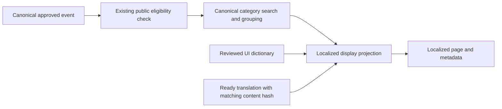

# Serbian English and Russian implementation plan

Status: implementation scope, prepared 2026-11-07. The user confirmed Serbian
at `/`, English at `/en`, and Russian at `/ru`. Serbian uses Latin script.
The implementation now adds the public interface, URL routing, metadata,
installation guidance, authentication copy and localized share images. The
Instagram icon, visible Follow label and official profile link remain beside
the language switcher, including at 320px. Existing source announcements remain
in their original language with a localized original-text label.

Implementation decision: use typed shared dictionaries and native Intl helpers
without adding a framework dependency. Keep existing page files; trusted
URL-bound middleware headers select the server locale, and public-only Next.js
beforeFiles rewrites resolve `/en` and `/ru`. This avoids middleware rewrite
re-entry and preserves the existing operational/auth routes. Language switching
loads a fresh document so root HTML and client providers agree. The next-intl
and route-tree restructuring below remain the original architecture proposal,
not the implementation shipped by this change.

The proposed background translation table and Russian-script search expansion
remain future capabilities. This release performs no paid translation calls or
canonical data writes. Only exact known generated summaries use deterministic
display translations; original main prose is preserved and untranslated new
language variants stay outside search alternates and indexing.

The first release should localize the complete public interface and metadata.
Translated event descriptions should use a separate display layer so language
selection cannot change event identity, classification, ingestion or moderation.
Clerk, Convex, OpenAI and Apify remain the existing services.

## 1. Locale and URL contract

| Setting | Serbian | English | Russian |
| --- | --- | --- | --- |
| Internal locale key | `sr` | `en` | `ru` |
| Visible prefix | none | `/en` | `/ru` |
| HTML and formatting language | `sr-Latn-RS` | `en-RS` | `ru-RS` |
| Search alternate language | `sr-Latn` | `en` | `ru` |
| Open Graph locale | `sr_RS` | `en_RS` | `ru_RS` |
| Timezone | `Europe/Belgrade` | `Europe/Belgrade` | `Europe/Belgrade` |

Per the user's updated preference, the collapsed switcher shows only a country
flag: Serbia for Serbian, the United Kingdom for English, and Russia for Russian.
The menu retains native language names beside the flags and accessible labels.
Flag SVGs are self-hosted from flag-icons, with its MIT license retained under
`public/flags/LICENSE.txt`. All interfaces use 24-hour time;
the language setting does not convert the event's timezone or ticket currency.
Serbian Cyrillic can be added later as an explicit locale, with editorial review.

The URL determines the rendered language. Disable automatic redirects based on
`Accept-Language`, IP or a preference cookie. A preference cookie may remember
an explicit switch, but must not change the content served at a fixed URL. The
switcher preserves the current event/venue ID, supported query parameters and
fragment. Existing unprefixed links continue to work and render Serbian.
Separate language URLs follow [Google's multilingual site guidance](https://developers.google.com/search/docs/specialty/international/managing-multi-regional-sites).

| Surface | Serbian | English | Russian | Indexing |
| --- | --- | --- | --- | --- |
| Calendar home | `/` | `/en` | `/ru` | Yes when translated |
| Discover | `/discover` | `/en/discover` | `/ru/discover` | Yes when translated |
| Map | `/map` | `/en/map` | `/ru/map` | Yes when translated |
| Event detail | `/events/{eventId}` | `/en/events/{eventId}` | `/ru/events/{eventId}` | Existing public eligibility plus language readiness |
| Venue detail | `/venues/{venueId}` | `/en/venues/{venueId}` | `/ru/venues/{venueId}` | Existing public eligibility plus language readiness |
| Venue directory | `/venues/directory` | `/en/venues/directory` | `/ru/venues/directory` | Yes; preserve meaningful `page` |
| Saved events | `/saved` | `/en/saved` | `/ru/saved` | No; preserve privacy |
| Profile | `/you` | `/en/you` | `/ru/you` | No |
| Installation guide | `/install` | `/en/install` | `/ru/install` | Existing page policy |
| Sign in and sign up | `/sign-in`, `/sign-up` | `/en/sign-in`, `/en/sign-up` | `/ru/sign-in`, `/ru/sign-up` | No; retain catch-all auth subpaths |
| SSO callback | `/sso-callback` | same | same | No; neutral operational callback |
| Admin | `/admin/**` | same | same | No; current operational interface |
| APIs, cron, assets | Existing paths | same | same | Existing policy |

Redirect equivalents must preserve queries: `/calendar` and `/events` go to
`/`; `/en/calendar` and `/en/events` go to `/en`; Russian equivalents go to
`/ru`. `/venues` goes to `/map?view=calendar`, with corresponding English and
Russian targets and the current query merge behavior. `/sr/...` normalizes to
the unprefixed Serbian URL. Unsupported locale routes return a real 404.
`/en/admin` and `/ru/admin` must not become alternate operational routes.

Do not translate path nouns, IDs or query values in this release. Keep `q`,
`month`, `day`, `date`, `venue`, `open`, pagination and existing category keys.

## 2. Current code and target architecture

The project is pinned to Next.js 15.5.20 and React 19.2.7. It has no existing
internationalization framework. Root HTML declares English, root SEO copy is
Serbian, and mobile, auth, install and taxonomy text mix languages. This is a
message extraction and routing change, rather than three copies of the app.

Use `next-intl` for typed messages, ICU plurals, server/client translation and
navigation. Select and lock a version whose peer dependencies support the
installed framework; verify it in a small branch before moving pages. Do not
upgrade Next.js or Clerk as part of this work. Use `middleware.ts` and the
Next.js 15 request-locale/static-rendering APIs, not newer `proxy.ts` or
`next/root-params` examples. The current upstream setup guide spans newer
framework versions: [next-intl routing setup](https://next-intl.dev/docs/routing/setup).

Proposed configuration, to be implemented after dependency verification:

```ts
defineRouting({
  locales: ["sr", "en", "ru"],
  defaultLocale: "sr",
  localePrefix: "as-needed",
  localeDetection: false,
  alternateLinks: false,
});
```

Generate search alternates centrally from page readiness instead of emitting a
second unconditional middleware alternate set. The optional default prefix is
supported by [next-intl routing configuration](https://next-intl.dev/docs/routing/configuration).

Proposed files:

```text
i18n/config.ts                       supported locales and language mapping
i18n/routing.ts                      prefix contract
i18n/navigation.ts                   locale-aware Link/router/path helpers
i18n/request.ts                      validated per-request dictionary loader
messages/sr.json                     reviewed Serbian Latin messages
messages/en.json                     reviewed English messages
messages/ru.json                     reviewed Russian messages
lib/i18n/format.ts                   display dates, numbers and plural helpers
lib/i18n/seo.ts                      canonicals, alternates, page-language metadata
components/navigation/language-switcher.tsx
app/(public)/[locale]/layout.tsx     public HTML/body and locale-scoped providers
app/(public)/[locale]/...            public and custom sign-in/sign-up pages
app/(operations)/layout.tsx         separate operational HTML/body and providers
app/(operations)/admin/...          existing protected admin pages
app/(operations)/sso-callback/...   existing neutral callback
```

Move the current root document into the localized public root, extracting
shared provider setup where appropriate. Remove the old top-level document
only after both root groups render correctly. Adding `[locale]` underneath
the existing root does not give that root access to the child locale parameter.
The localized root must render the correct `<html lang>` on the server. Await
route params under Next.js 15. Public-to-admin navigation crosses root layouts
and causes a full page load, which is acceptable for operational entry points.
These constraints follow the [Next.js 15 layout contract](https://nextjs.org/docs/15/app/api-reference/file-conventions/layout).

Keep `app/api`, sitemap, robots, icons and image endpoints outside localized
page segments. Handle localized not-found/loading/error states and framework
errors explicitly; invalid locale paths must not produce a Serbian page at an
arbitrary URL. Verify production build route manifests after the move.

### Existing file mapping

| Current files or area | Required implementation |
| --- | --- |
| `app/layout.tsx`, `next.config.mjs`, `middleware.ts` | Locale root, dictionary provider, composed routing/auth, legacy redirects |
| `app/page.tsx`, `app/(main)/events-browse-page.tsx` | Calendar headings, counters, filters, date formatting and metadata |
| `app/(main)/discover`, `components/discover` | Feed copy, empty/error/loading states, date labels and locale-aware links |
| `app/(main)/map`, `components/maps/event-calendar-map.tsx` | Controls, accessible map labels, popups and linked event/venue paths |
| `app/(main)/events/[eventId]/page.tsx`, `components/events` | Labels, source notices, share UI and localized description projection |
| `app/(main)/venues/[venueId]/page.tsx`, `venues/directory/page.tsx` | Place labels, hours, pagination, category display and linked event paths |
| `app/(main)/saved`, `you`, `components/auth/you-profile-panel.tsx` | Guest/account copy, privacy, saved counters and safe return links |
| `app/(main)/install`, `components/install` | Browser-specific installation instructions and announcements |
| `components/navigation/app-toolbar.tsx`, `profile-avatar-link.tsx`, `navigation-feedback.tsx` | Labels, active states, auth route detection, focus/announcement copy |
| `lib/navigation/mobile-navigation.ts` | Normalize route kind before date propagation and public prefetch allowlisting |
| `components/calendar/calendar-scroll-restoration.tsx`, `calendar-event-preview.tsx` | Recognize prefixed routes and preserve locale in back destinations and scroll keys |
| `components/calendar`, `components/events/event-meta.tsx` | Complete strings, pluralization, filters and accessible labels |
| `lib/taxonomy/event-categories.ts`, `venue-types.ts` | Translate display labels through stable keys; preserve classification rules |
| `lib/events/event-time*.ts`, `calendar-time-band-definitions.ts` | Separate display message keys from stored sentinel/time calculations |
| `components/auth/email-auth-card.tsx`, `lib/auth/email-sign-in.ts` | Localize custom Clerk forms and known error-code messages |
| `lib/seo/site.ts`, page metadata, `app/opengraph-image.tsx` | Locale-aware titles/descriptions/FAQs/breadcrumbs and social metadata |
| `app/sitemap.ts`, `lib/seo/sitemap-data.ts`, `app/robots.ts` | Ready language variants, equivalent alternate sets and private exclusions |
| `lib/analytics/model.ts`, `components/analytics/visitor-tracker.tsx` | Validate locale prefixes; retain canonical route aggregation without losing localized traffic |
| `app/manifest.ts`, `components/install`, `app/globals.css` | Stable installed-app identity, locale-aware launch choice and script layout checks |
| `app/api/events/[eventId]/export/route.ts`, `lib/social/public-event-export.ts`, `event-export-image.ts` | Explicit validated locale and locale-sensitive rendered image cache |

Do not replace the current Clerk middleware with a generic localization
middleware. Preserve fail-closed admin behavior, allowlist checks, malformed
cookie recovery and authenticated user APIs. Locale rewrites never wrap API,
cron, asset or admin paths. Check authorization before any operational route
execution and retain all existing safe-redirect checks.

## 3. Translation mapping and editorial rules

The accompanying [draft translation catalog](i18n/ui-translations-draft.json)
maps semantic keys to current source strings, file locations and `sr`, `en`,
`ru` drafts. Source text is not assumed to be English: current Serbian copy is
recorded as Serbian. Proposed controls are identified separately. The catalog
is review input, not a runtime dictionary or a claim of complete site coverage.

Convert reviewed entries into nested runtime dictionaries. Use namespaces such
as `nav`, `calendar`, `filters`, `event`, `venue`, `saved`, `auth`, `install`,
`errors`, `accessibility` and `seo`. Infer TypeScript keys from a source
dictionary; validate key and interpolation parity across all three languages.
Do not select messages with the displayed English sentence as an identifier.
The existing search placeholder mentions genre although the current search
contract covers event names, artists and venues. The draft corrects that copy
without extending search behavior.

Translate complete phrases. Retain the same named parameters across locales.
Use ICU `one`, `few`, `many` and `other` as applicable, with a mandatory `other`
branch, rather than concatenating a number with a noun. For example, event
counts in Russian and Serbian need different forms for 1, 2 and 5. Use ICU
rich-text tags for linked instructions instead of embedded translated HTML.
See [next-intl message and plural support](https://next-intl.dev/docs/usage/translations).

| Content | Translation treatment |
| --- | --- |
| Navigation, headings, buttons, empty/error/loading states | Full reviewed translation |
| Accessible names, tooltips, status announcements, input placeholders | Same completeness as visible UI |
| Dates, weekdays, months, counts, numeric prices | Locale formatting, explicit timezone/currency rules |
| Categories and genre labels | Display mapping after canonical classification |
| Event titles, artists, venue names and addresses | Preserve announced proper names and official spelling |
| Original Instagram captions and posters | Preserve original content; label original text and its actual language when known |
| Event descriptions and reviewed prose updates | Separate versioned display translations |
| Time, date, event ID, venue ID, query values and status enums | Preserve machine values |
| Source conflicts, moderation notes, receipts, analysis and logs | Preserve original operational evidence |

Editorial review must check Serbian Latin diacritics and idiom, natural Russian
wording, short mobile labels, consistent formal/informal tone and auth error
clarity. Do not automatically translate a venue name into an ordinary noun or
claim a performance is in Russian because the interface is Russian. Native
speaker review remains a prelaunch task. Custom auth, installation, FAQs and
SEO copy need a second extraction pass beyond the initial seed catalog.

Keep unknown starts as `TBD` in storage and translate the displayed unknown-time
label. Distinguish confirmed event time from venue opening hours and inferred
end time. Keep date-only values as date keys; format them using deliberate
date-only handling rather than browser-local midnight conversion. Actual
timestamps use `Europe/Belgrade`, including daylight saving changes.

Preserve source price conditions. A string such as free entry before 23:00 and
a charge later must not become simply "Free". Use numeric currency formatting
only when amount and currency are known; do not infer or convert an amount.

## 4. Dynamic event content without changing ingestion

Static UI requires no event-schema change. Initially, known generated summary
templates can be rendered from canonical facts using translated templates.
Apply this only to recognized templates, not by guessing that arbitrary prose
is a template. Original custom descriptions remain available with an original
language label until a verified translation is ready.

For longer descriptions, add a separate `eventLocalizations` table later:

| Proposed field | Purpose |
| --- | --- |
| `eventId` | Existing canonical Convex event ID |
| `locale` | Validated `sr`, `en` or `ru` |
| `sourceContentHash` | Hash of exact translatable text and relevant canonical context |
| `sourceLanguage` | Verified/detected original text language, with unknown supported |
| `description` | Translated display prose |
| `reviewedSourceUpdateText` | Optional translated display of the existing reviewed update; original source URL retained |
| `status` | `queued`, `ready`, `failed` or `needs_review` |
| `translatorVersion`, model/reviewer metadata | Reproducibility and review |
| `createdAt`, `updatedAt` | Translation record timestamps |

Use an index on `(eventId, locale)` and a transaction that enforces one current
record per pair. Validate supported locales and bounded field lengths. Include
content and policy version in the job idempotency key. Hash the fields used by
the translator, rather than invalidating translations on every moderation-only
change to `event.updatedAt`.

The job reads an approved, publicly visible canonical event, translates only
allowed prose, preserves names/numbers/negations/conditions and checks the
input hash again before saving. Use bounded background work and a separate
cost ledger, concurrency limits and retries; coordinate with existing provider
capacity limits without using ingestion source leases. A translation request
must never start an Apify fetch or re-run extraction. No paid work runs during
page rendering, language switching or metadata generation.



The display projection is applied after category/filter/dedupe decisions.
`events.description` currently contributes to taxonomy and duplicate logic;
overwriting it would change behavior. Do not translate or rewrite `events`,
`scrapedPosts`, raw/normalized extraction, occurrence facts or receipt payloads.
Keep the current `EVENT_PRIMARY_CATEGORIES` and `TAG_RULES` label values intact
as well as their keys: existing classification compares those labels and some
consumers recognize the canonical free-entry tag by its Serbian label. Add
translated display mappings after those decisions, rather than editing the
canonical taxonomy arrays. When translating a reviewed source update, its
content hash includes the update text, `sourceUrl` and `sourceEventId`; rendering
keeps both original source references.

Missing, failed or stale translation falls back to canonical text with the
appropriate original-language label. It does not hide a valid event or block
its ingestion receipt. Public reads still reject hidden/rejected events even
if a ready translation exists. Batch overlay lookups for visible cards; avoid
one Convex query per card. Invalidate overlays after content changes, event
mergers or deletion, using the existing canonical ID lifecycle.

Public search currently matches names, artists, places and venue aliases, not
descriptions. Keep that scope. Shared `toSearchableText` is part of ingestion
identity and drops some Russian-only characters. If Russian-script discovery
is added, implement a public-search-specific Unicode/transliteration alias
layer, deduplicate by event ID and use the same matching contract for list
results and calendar counts. Do not change shared venue identity normalization
as a side effect of localization. Stage this after the UI release.

## 5. SEO, auth, caching and secondary surfaces

Generate localized titles, descriptions, breadcrumbs, FAQs and social metadata
using the [Next.js 15 Metadata API](https://nextjs.org/docs/15/app/api-reference/functions/generate-metadata).
Each indexable language page has a self-canonical and the same reciprocal set
of currently ready language variants. The complete set is `sr-Latn`, `en`,
`ru`, plus `x-default` pointing to the equivalent Serbian URL. Use absolute
canonical-origin URLs. Entity IDs in Event/Place
JSON-LD remain stable across all languages, while WebPage URLs are localized.
Use [Google's alternate-page requirements](https://developers.google.com/search/docs/specialty/international/localized-versions)
for self references and return links.

As a launch policy, add only fully prepared language variants to sitemaps and
alternate sets. A temporary English/Russian page whose substantial main prose
still falls back to another language stays usable but `noindex` until ready.
Serbian's existing indexability is retained. Names, addresses and original
source quotes do not themselves make a page untranslated. Define readiness per
page: UI/metadata plus generated summaries or translated substantial prose.
Do not make page indexing depend on an optional short source caption being
translated. Automatically generated alternate headers must follow the same
readiness policy or remain disabled.

Set page/content language on the HTML document and any original-language text
block. `Event.inLanguage` describes event content/performance and must not be
filled from the visitor's UI language; omit it when unknown. The distinction
comes from [Schema.org's inLanguage definition](https://schema.org/inLanguage).
Keep source-backed date/time/location/performer facts in structured data and
do not introduce unannounced start times through translated summaries.

Keep saved/profile/auth pages `noindex` across locales and add operational
robots exclusions where needed. Preserve the poster-proxy allow rule. Filtered
calendar URLs should retain the existing canonical policy, and directory page
numbers should retain their existing meaningful canonical distinctions.

The app uses custom headless Clerk forms. Translate their copy and known error
codes directly; a provider language pack alone cannot translate them. If
provider-rendered components need language packs, verify a compatible
`@clerk/localizations` version and review Serbian Latin overrides rather than
assuming `srRS` uses the chosen script. Keep `/sso-callback` stable and restore
a validated locale-aware return path. Prevent localized sign-in redirect loops
and external redirect injection. In particular,
`components/auth/email-auth-card.tsx:getSafeRedirectPath` currently excludes
only unprefixed auth paths. Validate and normalize locale prefixes before
rejecting auth return targets; test `/en/sign-in` and `/ru/sign-up` loop cases.
See [Clerk localization scope](https://clerk.com/docs/guides/customizing-clerk/localization).

| Data or cache | Locale treatment |
| --- | --- |
| Raw approved-event reads, canonical IDs, category groups and counts | Shared; no extra per-locale scan |
| Rendered pages and dictionary bundles | Keyed by validated URL locale and dictionary version |
| Translated prose | Event ID + locale + content hash/version |
| Calendar navigation/scroll and rendered client snapshots | Locale in presentation state; retain selected date/filter values |
| Poster originals and responsive derivatives | Existing source checksum/storage keys; same image across languages |
| Localized share JPEG and OG rendering | Add locale and dictionary/design version to the existing factual cache key |
| Guest saves, account saves and venue favorites | Existing ownership partitions and canonical IDs; never locale copies |
| Analytics | Allow validated prefixed routes; preserve canonical route grouping and optionally report locale separately |

Extend APIs with locale only where they return localized output; keep existing
response defaults backward compatible. Language-neutral counts and media do not
need a locale parameter. Translate public errors through stable client message
codes rather than matching server error text. Keep public/private eligibility
checks before cache access and preserve authenticated `no-store` behavior.

The current event export is a JPEG story image, not an ICS calendar feature.
Localize user-triggered export labels and dates explicitly. Existing scheduled
Instagram/n8n output keeps its current language unless separately changed.
Keep one stable PWA `id`/scope so language changes do not create three installed
apps. Persist an installation launch preference without changing deterministic
language URLs. Existing CSS already includes a Cyrillic fallback font; test its
Russian glyphs, weight coverage and mobile line breaks rather than adding
another font without measurement.

## 6. Delivery sequence

| Phase | Work and dependencies | Completion condition |
| --- | --- | --- |
| 1. Inventory and editorial preparation | Finish current-string extraction, review the draft catalog, glossary, plural/rich-text cases and complete SEO/FAQ/install/auth copy | All in-scope messages mapped; no invented runtime keys treated as shipped |
| 2. Locale foundation | Pin compatible next-intl; add routing/dictionaries/formatters; restructure roots; compose middleware; implement switcher and redirects | Correct server HTML language and same entity/query on all routes; operational auth intact |
| 3. Public interface | Calendar/discover/map/detail/venues/saved/profile/auth/install plus accessibility; migrate link/path helpers and analytics | No mixed interface copy; mobile, keyboard and auth flows work in all languages |
| 4. Content and SEO | Deterministic summary templates; additive prose translations; readiness rules; metadata, JSON-LD, sitemap and share export | Public language versions have appropriate main content, reciprocal alternates and correct facts |
| 5. Verification and rollout | Full QA/build; preview crawl; staging source snapshots and locale parity; deploy matching web/social release image | Release acceptance below passes and production smoke checks match the reviewed build |
| 6. Optional expansion | Public Russian-script search aliases, Serbian Cyrillic, admin UI, translated automated social output | Separate scoped acceptance; no implicit expansion of the first release |

Estimated engineering effort: 7-12 working days for phases 1-5, plus native
speaker review and the initial description translation batch. This is a planning
range, not a measured schedule. Routing/auth regression work and the size of
custom prose determine the upper end. The public Russian search expansion and
admin translation are outside that estimate. Split review into foundation,
public UI, then content/SEO changes so source invariants can be checked at each
step.

Prepare and test preview routes with crawling disabled before production
exposure. On launch, make ready language routes and their metadata live
together; add sitemap entries only for those ready routes. Use the existing VPS
release procedure and identical web/social image requirement. Rolling back the
frontend must leave additive translation records harmless and preserve existing
unprefixed URLs; do not delete canonical data to reverse localization.

## 7. Release acceptance

1. Every supported route renders correct HTML language and initial translated
   content without a client language flash or hydration disagreement.
2. Direct loads, refresh, links, redirects and switching preserve event/venue
   identity and query parameters across all three languages. Invalid locales
   return 404; operational/API paths retain their existing boundaries.
3. Equal filters produce equal canonical event IDs, counts, venue IDs, category
   keys and time facts in every locale. Locale switching causes zero canonical
   event, source, receipt or moderation writes and zero paid provider calls.
4. Kolarac's 18:30 and 20:30 programmes remain separate; Karma Koma's
   23:00-06:00 programme remains continuous; Pad Kra Pao remains one programme;
   independently named Sprat and Zaokret programmes remain separate. These are
   regression fixtures for presentation invariance, not new extraction rules.
5. Source captions, raw analysis, normalized evidence, occurrence facts and
   receipt payloads remain byte-identical after translation generation.
6. Key/placeholder parity and ICU syntax pass. Check plural values 0, 1, 2, 5,
   11, 21, 22, 25 and 101 in all locales; missing keys fail CI. Reviewed runtime
   dictionaries contain no draft or untranslated interface entries.
7. Belgrade dates, daylight saving boundaries, unknown starts, venue-hour
   context, overnight ranges and conditional prices retain their semantics.
8. Login/signup/reset/verification/callback/logout, malformed cookies, guest
   save migration and favorites retain ownership and validated locale returns.
   Private content is never prefetched or cached into a shared public view.
9. Missing/stale/failed prose translations fall back safely; content changes
   invalidate old overlays; hidden/rejected/deleted events remain unavailable
   in every language and through export/image endpoints.
10. Every advertised alternate is public, ready, self-canonical and reciprocal.
    JSON-LD entity identity and source-backed facts match all variants. Auth,
    profile, saved and operational routes preserve exclusion policy.
11. Test Russian and Serbian on 320px/375px phones and desktop, with keyboard
    navigation, screen readers, long names, font loading, dialogs and maps.
    Verify actual rendered Cyrillic in exported images as well as HTML.
12. Update existing path/language assertions in `qa-seo.mjs`,
    `qa-app-toolbar.mjs`, `qa-mobile-navigation.mjs`, `qa-framework-compat.mjs`,
    auth, analytics, public performance and navigation tests. Add focused locale
    tests rather than weakening existing assertions. Run `npm run qa:release`
    and `git diff --check`; build failures block rollout.

Full multilingual readiness means phases 1-5 pass. A translated toolbar alone
does not complete the interface, content, auth and SEO work mapped here.
